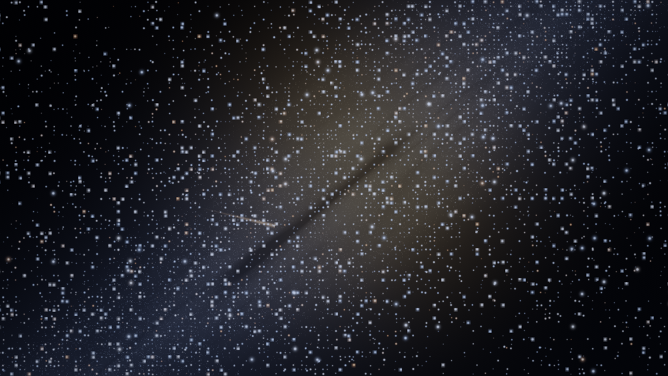
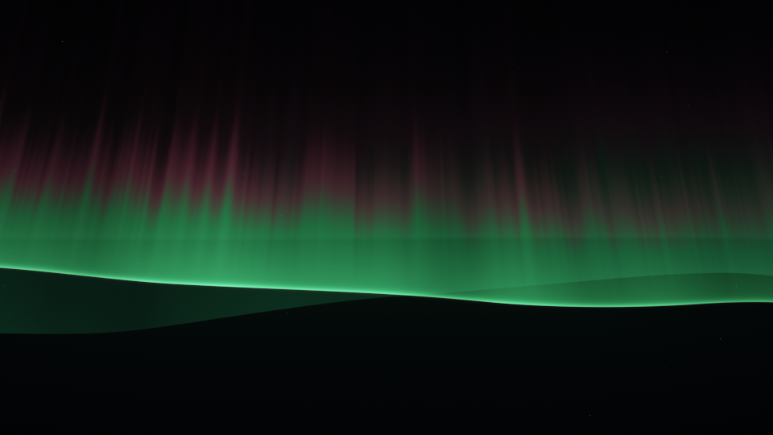
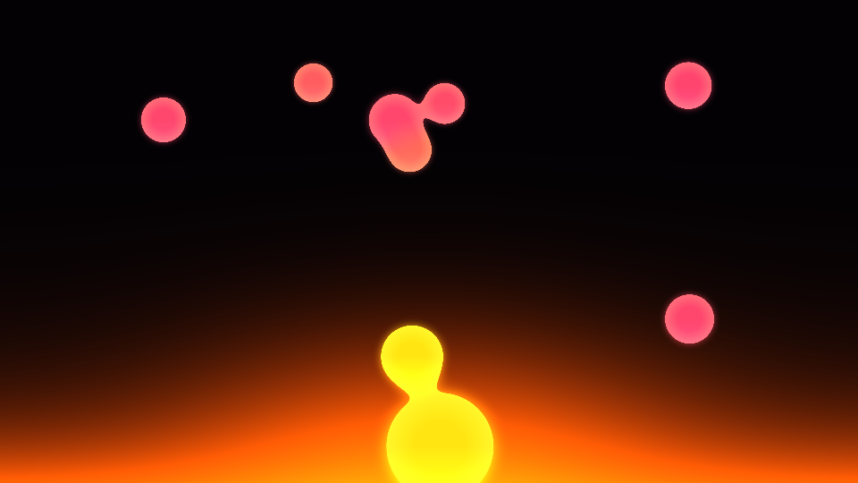
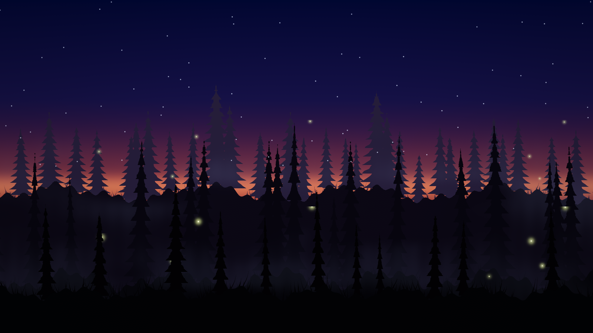
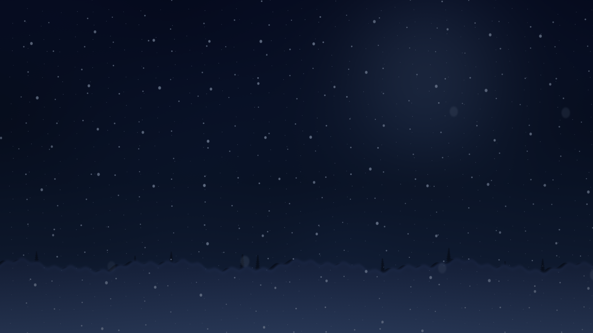

# Stalgia

Lightweight animated desktop wallpapers and a desktop widget for Windows 10 and 11, drawn behind your icons by one portable Direct3D 11 executable. Matrix rain, Stars, Aurora, Lava, Fireflies, and Snow.











Stills above are from the CPU reference renderer (`tools/render_sky.py` and `tools/render_lava_preview.py`), not screenshots of a desktop.

## Features

- **Matrix** — falling katakana, instanced on the GPU.
- **Stars** — a dark sky, crisp stars, and a Milky Way. Still night, Milky Way, and Nebula stay at 30 fps. Warp follows the global cap.
- **Aurora** — one folded ribbon with a green hem and magenta rays, and an optional ridgeline with a reflection.
- **Lava** — opaque wax inside the lamp. Blobs pinch off the bottom pool and drift up. Default is 30 fps.
- **Fireflies** — a dusk forest. Layered treelines drift with a little parallax, fireflies blink with a warm yellow-green bloom, and a faint mist sits on the ground. Summer dusk, Deep woods, and Meadow. An optional starry sky sits above the trees. Default is 30 fps.
- **Snow** — flakes in depth: big soft ones near the camera, small sharp ones far away, with a slow drift, a slight sway, and optional wind. Backdrops are Night sky, Pine forest, and Window. Default is 30 fps.
- **Widget** — a frameless card on the desktop: live preview, wallpaper picker, play/pause, FPS, hide-icons, presets, and a System strip (CPU, RAM, GPU, disk, network). It collapses to a small pill. It is a top-level window, not a child of Explorer.
- **Gallery** — groups, live cards, favorites, and the same knobs as the widget.
- **Tray and control panel** — show or hide the wallpaper, pause, pick an effect, open the config, or exit. Closing the panel leaves the wallpaper running.
- Frame rate is capped (default 30). Fullscreen, a covered desktop, and battery saver can pause rendering. Start with Windows is off until you turn it on.

Every wallpaper also has brightness, saturation, vignette, an FPS cap, a night palette, and optional mouse parallax.

## Install

Download `Stalgia-<version>.exe` from [GitHub Releases](https://github.com/pr4wn-dev/Stalgia/releases). No installer. Nothing is written to `HKCU\...\Run` until you opt in.

1. Double-click the exe. The widget appears over the wallpaper, and a tray icon appears near the clock.
2. Matrix rain should fill the desktop behind the icons. Switch wallpapers from the widget, the tray, or `Stalgia.exe --panel`.

Optional per-user copy (still does not enable autostart):

```text
Stalgia.exe --install
```

That copies the exe to `%LOCALAPPDATA%\Programs\Stalgia\Stalgia.exe`, writes a desktop shortcut, and launches the copy. `Stalgia.exe --uninstall` removes that copy, the Run key, and the shortcut, and restores desktop icons. `%APPDATA%\Stalgia\config.json` is left in place.

Preview in a window without touching the desktop:

```text
Stalgia.exe --window --wallpaper fireflies
```

### Unsigned builds

Current release builds are unsigned while a SignPath Foundation application is pending. Windows SmartScreen may say **Windows protected your PC**. Choose **More info**, then **Run anyway**. If the file was downloaded from the internet, unblock it in **Properties**.

Windows 11 Smart App Control, when it is on and enforced, can block an unsigned exe with Code Integrity events such as 3077, 3033, and 3118 (`An Application Control policy has blocked this file`). That is a signing-policy block, not a fault in the wallpaper.

Once a signed release is published, Windows releases will use free code signing provided by SignPath.io, certificate by SignPath Foundation. See [Code signing policy](#code-signing-policy). The GitHub Actions artifact is named `Stalgia-unsigned` so a signing step can run before the release is published.

## Code signing policy

Free code signing provided by SignPath.io, certificate by SignPath Foundation.

Windows release binaries (`Stalgia-<version>.exe` on [GitHub Releases](https://github.com/pr4wn-dev/Stalgia/releases)) will be signed only after a SignPath Foundation application is approved. Until then, published builds remain unsigned. Only binaries built from this repository by the GitHub Actions release workflow are submitted for signing. The private key is held by SignPath on an HSM; this project does not store it. Each signing request requires manual approval by an approver. Local or developer-machine builds are not signed.

### Team roles

This is a single-maintainer project. All of the following roles are held by [pr4wn-dev](https://github.com/pr4wn-dev):

- **Authors (committers):** people trusted to modify the source code without additional reviews — [pr4wn-dev](https://github.com/pr4wn-dev).
- **Reviewers:** changes proposed by people who are not committers (for example, pull requests) are reviewed by [pr4wn-dev](https://github.com/pr4wn-dev) before merge.
- **Approvers:** each signing request is approved by [pr4wn-dev](https://github.com/pr4wn-dev).

## Privacy policy

This program will not transfer any information to other networked systems unless specifically requested by the user or the person installing or operating it.

Settings, logs, and crash reports stay on the local PC under `%APPDATA%\Stalgia`. Optional features that change the system (Start with Windows, a per-user copy via `--install`, and hiding desktop icons) are off until the user turns them on, and can be reversed with `--uninstall` or the in-app controls.

## Command line

| Option | Meaning |
| --- | --- |
| `--window`, `-w` | Preview window. Does not attach to the desktop. |
| `--wallpaper NAME`, `--effect NAME` | Start with `matrix`, `starfield`, `aurora`, `lava`, `fireflies`, or `snow`. A running instance switches to that wallpaper. |
| `--panel` | Open the control panel. A running instance opens its own panel. |
| `--widget` | Show the desktop widget. |
| `--hide-widget` | Hide the desktop widget on a running instance. |
| `--install` | Copy to `%LOCALAPPDATA%\Programs\Stalgia`, add a desktop shortcut, and launch. Does not enable Start with Windows. |
| `--uninstall` | Quit a running instance, remove the Run key and shortcuts, restore icons, and delete the per-user install folder. |
| `--diag` | Log the Progman/WorkerW/DefView tree, monitors, and DPI, then exit. Read-only. |
| `--exit` | Tell a running instance to quit and restore the static wallpaper. |
| `--icons hide\|show` | Hide or show desktop icons, the same command as Explorer’s View menu. Restored on exit. |
| `--selftest` | Attach, check visibility, exercise the gallery and widget settings, and cycle presets. Writes `%APPDATA%\Stalgia\selftest.txt`. Exits nonzero on failure. |
| `--capture` | With `--selftest`, write a PNG of every preset to `%APPDATA%\Stalgia\capture`. |
| `--console` | Attach a console. |
| `--help`, `-h` | Short help. |

A second desktop instance is refused. Flags sent while Stalgia is already running are delivered to that instance. Preview mode can run beside the desktop wallpaper.

Logs: `%APPDATA%\Stalgia\stalgia.log` (rotated to `stalgia.log.1` at about 2 MB). A crash writes a minidump and the last log lines under `%APPDATA%\Stalgia\crash`.

## Config

On first launch Stalgia writes `%APPDATA%\Stalgia\config.json`. If `%APPDATA%\DesktopRain\config.json` exists and Stalgia’s does not, it is copied over (the app used to be named Desktop Rain). A `config.json` next to the exe is used instead, as a portable file.

See `config.example.json`. `version` is the JSON format (currently **2**). `effect` is one of the wallpaper ids. Colors are `#RRGGBB`. `tune.*` is a generation number per wallpaper: when a release changes that wallpaper’s defaults, an older saved block is reset. Custom glyphs, photo paths, and the parallax toggle are kept.

`showWidget`, `widgetMini`, `widgetX`, and `widgetY` place the widget. `hideDesktopIcons` uses the same Explorer command as **View → Show desktop icons**. Start with Windows is off on a new config.

## Build from source

Requirements: Windows 10 or 11, 64-bit, and a Direct3D 11 GPU. A CJK font is optional; Matrix falls back to Latin glyphs. There is no .NET runtime, no VC++ redistributable, and no Python at runtime.

The GitHub workflow (`.github/workflows/build.yml`) cross-compiles the same way.

### MinGW-w64

On Debian or Ubuntu, including a GitHub `ubuntu-latest` runner:

```bash
sudo apt-get update
sudo apt-get install -y --no-install-recommends \
  cmake make clang \
  gcc-mingw-w64-x86-64-win32 g++-mingw-w64-x86-64-win32 \
  mingw-w64-x86-64-dev binutils-mingw-w64-x86-64
cmake -S . -B build-mingw -DCMAKE_TOOLCHAIN_FILE=cmake/mingw-w64-x86_64.cmake -DCMAKE_BUILD_TYPE=Release
cmake --build build-mingw -j
```

The toolchain file selects the win32-thread compilers (`x86_64-w64-mingw32-g++-win32`). The link line is `-static -static-libgcc -static-libstdc++ -municode -mwindows`, so the result is one portable exe: `build-mingw/Stalgia.exe`. Clang compiles `src/host/SehGuard.c` because MinGW g++ has no `__try`.

Optional effects that are not in this repository can be compiled in with `-DSTALGIA_PRIVATE_EFFECTS_DIR=/absolute/path/outside/the/repo`. The directory supplies extra `.cpp` files and a `registerPrivateEffects` function. Leave it unset for the public build. A saved `effect` id that this build does not contain falls back to Matrix.

### MSVC

```powershell
cmake -S . -B build -G "Visual Studio 17 2022" -A x64
cmake --build build --config Release
```

The exe is `build\Release\Stalgia.exe`. Release uses the static CRT (`/MT`).

## License

Stalgia is free software under the GNU General Public License v3.0 only. See [LICENSE](LICENSE). The version resource reports `LegalCopyright` as `GPL-3.0`.

No third-party source is vendored. The exe links only to Windows system libraries (Direct3D 11, DXGI, Direct2D, DirectWrite, DirectComposition, the shell, GDI, PDH, and the rest). Matrix glyphs are drawn with a font already installed on the PC. The app icon (`resources/app.ico`, `resources/stalgia-256.png`) is the project’s own art. Matrix rain is an homage to a film look, not an official product.
